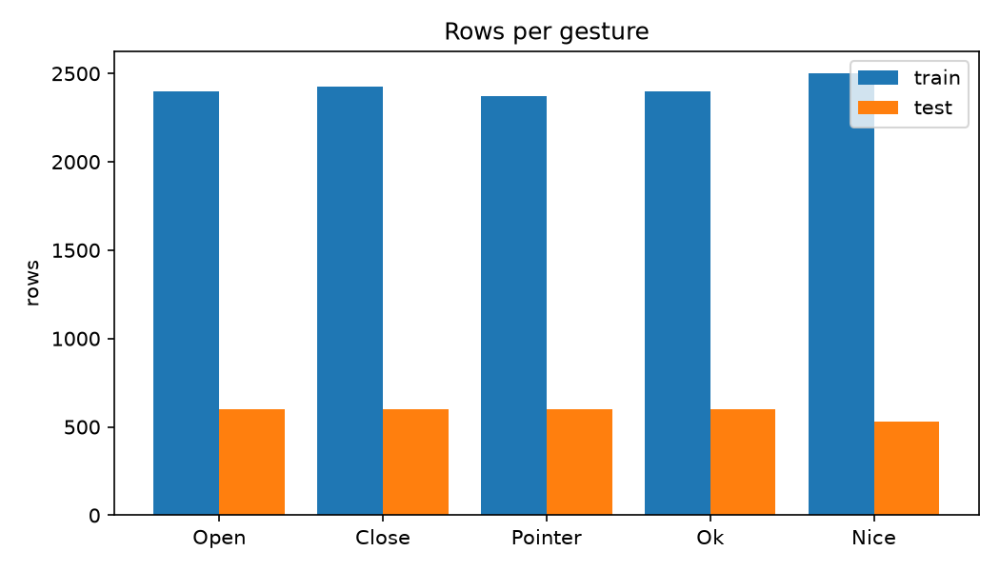
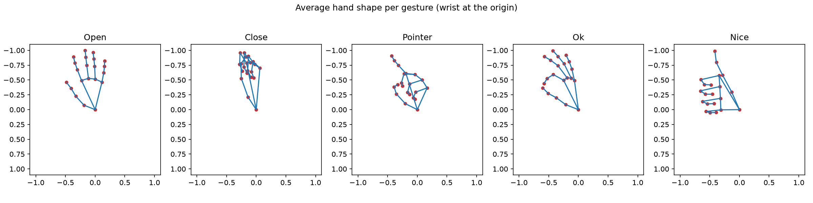
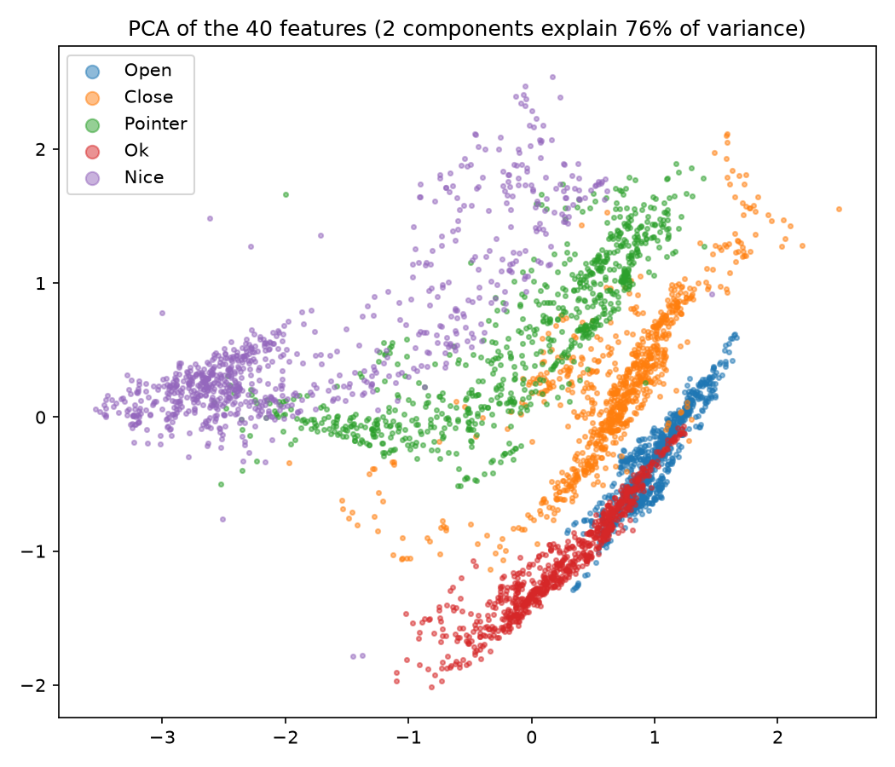
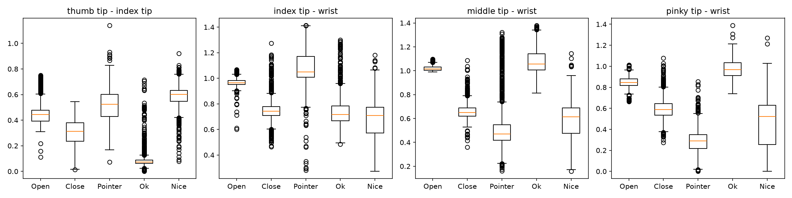
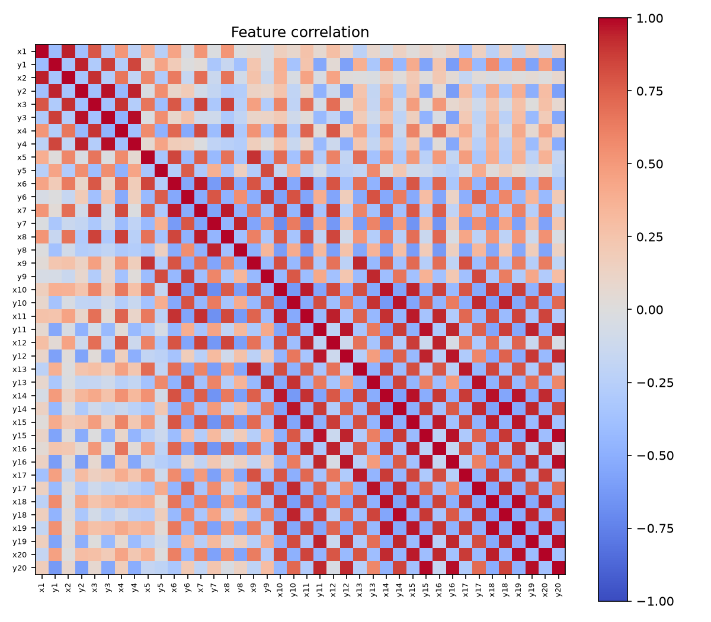

# GestureFlow | Webcam-based media control

Muhammad Aarib Ali (24p-3036), Muhammad Shafay Naeem (24p-3089) and Muhammad Abdullah (24p-3041)

## 1. Problem statement

Can a user pause a track, mute audio or change volume with one hand while staying away from the keyboard? GestureFlow translates five deliberate static poses into Linux media commands. For a toggle such as mute, one correct action per hold matters more than the number of correctly classified frames. The system must also recognise when the user intends no action.

## 2. Dataset and source

The benchmark uses the static portion of the CC BY 4.0 landmark dataset by Yefri Estiven Vera Morales and Jesus Camilo Perafan Ledezma. Our headerless CSV contains 15,029 labelled poses across Open, Close, Pointer, Ok and Nice. The record description lists 15,028. An earlier silhouette dataset yielded zero detected hands in 15,998 images, so it could not supply landmarks for this pipeline. [Zenodo dataset, DOI 10.5281/zenodo.20032888](https://doi.org/10.5281/zenodo.20032888) · [Silhouette evaluation](rejected_dataset.md)

## 3. Preprocessing and split

Each pose has 21 two-dimensional landmarks. Using the wrist as the origin makes its two coordinates constant. Removing them leaves 40 inputs scaled to −1 through 1. We found no missing values or exact duplicate rows. Adjacent same-class rows differed by 0.0164 per coordinate on average, compared with 0.1584 for random same-class pairs. We therefore assigned whole chunks of up to 100 consecutive same-class rows to training (12,097 rows) or testing (2,932). Adjacent chunks may still share a recording.

## 4. Exploratory data analysis

Training counts ranged from 2,374 Pointer examples to 2,500 Nice examples. The mean skeletons show why some gestures are easier to distinguish. Open and Ok have the closest mean poses, while the thumb-to-index fingertip distance is especially small for Ok (median 0.074).

The first two principal components explain 76.0% of the variation in the plotted sample. Open and Ok overlap in the lower-right band. Nice clusters farther left, with some overlap with Pointer in the middle.

Neighbouring joints often move together. The index fingertip and its nearest joint have a horizontal-coordinate correlation of 0.958. The corresponding vertical coordinates on the pinky have a correlation of 0.979.

## 5. Four-model benchmark

The four classifiers used the same features and three grouped, stratified training folds. We selected the model by mean cross-validation macro-F1, which gives each class equal weight. The held-out test set was scored after selection.

| Classifier | CV macro-F1 | Test accuracy |
|---|---:|---:|
| Multilayer perceptron | 99.35% | 98.53% |
| Random forest | 98.98% | 99.59% |
| Support vector machine | 98.87% | 98.53% |
| K-nearest neighbours | 98.83% | 98.87% |

## 6. Selected model and evaluation

The MLP won the prespecified selection metric. Random forest achieved the highest test accuracy. The MLP maps 40 inputs to 64 hidden units. Each computes a weighted sum plus a bias, and ReLU keeps positive values. A softmax output converts the final scores into class probabilities. During training, Adam updates weights using gradients of the classification loss. The most common benchmark error was predicting Open for Ok (34 of 43 errors), consistent with the overlap in the mean poses.

The deployed MLP adds a sixth output, Idle. We used 1,518 deliberate-gesture frames and 1,502 Idle frames from one participant alongside the Zenodo training data. We reserved three entire Idle takes (508 frames) for evaluation. The deployed model scored 98.4% on Zenodo gestures and recognised 88.6% of held-out Idle frames. [Model comparison and training parameters](model_comparison.md)

In a fresh two-hand session, all ten deliberate holds triggered exactly once, and relaxed hands produced zero triggers in 30 seconds. Casual fidgeting produced nine false triggers in 30 seconds. Increasing confidence from 0.70 to 0.80 left all nine. In an earlier session, a 0.77-second prediction gap caused a held fist to trigger twice. The tests establish performance for one participant only.

## 7. Web application

The Flask dashboard displays the webcam feed, landmarks, probabilities and action log. Users select their hand and player, enable control in dry-run mode, and switch to LIVE for system actions. Left-hand mode mirrors the horizontal coordinates. At the default settings, five qualifying votes in seven frames and a stable hold of 0.4 seconds confirm a gesture. Open toggles playback, Close toggles mute, Nice skips a track, and Pointer and Ok raise and lower volume while held. Idle sends no command. Image upload supports single-photo predictions. [Setup and controls](../README.md)

## 8. Submission materials

The repository contains the source, trained models, pinned environment, figures and recorded evaluation outputs. The demo video link is pending recording and upload. [Source code](https://github.com/muhammadaaribali/gestureflow) · [Demo checklist](demo_checklist.md)
